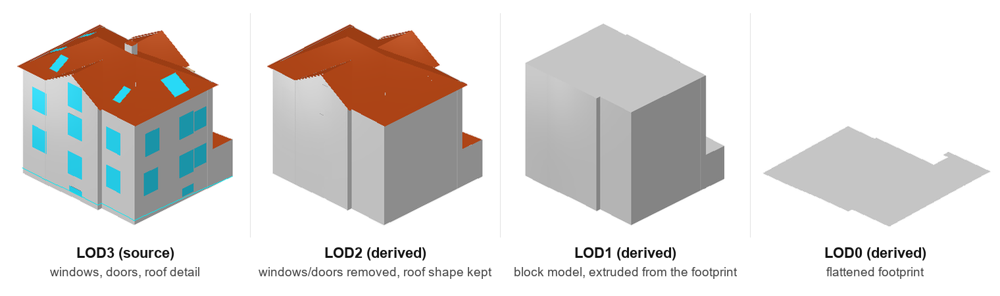

# CitySmith

A blacksmith for CityGML. CitySmith is a command line toolkit for 3D city
models in **CityGML 2.0**. It takes the buildings in a CityGML file and
reshapes them: deriving lower levels of detail, filling in missing
semantics, checking the file against the CityGML standard and its geometry,
combining and cutting files, and converting to CityJSON. The input file is
never changed; every result is written to a new file.

Seven commands: `inspect` reports what a file contains and what CitySmith
can do with it, `crop` extracts a named subset of buildings out of a larger
file, `merge` combines several files into one, `lod` derives lower levels of
detail (LOD1 and LOD0 from either LOD2 or LOD3 data, a clean LOD2 from
LOD3), `semantics` fills in missing ids and semantic attributes, `convert`
exports to CityJSON, and `validate` checks the file against the official
CityGML 2.0 XML schemas and its geometry, natively or through the
CityDoctor2 bridge.

> Status: early development. All seven commands work end to end and are
> tested, and every file CitySmith writes is checked against the official
> CityGML 2.0 schemas in its test suite. See the
> [Roadmap](docs/DESIGN.md#roadmap) for what's planned next.

## Example output

The same real building (`tests/lod/CS1_lod3.gml`, a CityGRID-style export with a
Building and a BuildingPart) derived from LOD3 down to LOD0 with `citysmith lod`:



Every file shown is in `tests/`, reproducible with
`citysmith lod tests/lod/CS1_lod3.gml --levels 0,1,2`. This building is a real
export from CityGRID®, UVM Systems GmbH's software (see
[Which export style is my data?](#which-export-style-is-my-data) below).

## Why

Detailed 3D city models in CityGML (LOD2 and, more and more, LOD3) are
increasingly available, but many uses need something simpler or more
complete than what was delivered: a lower level of
detail for simulation or visualisation, missing ids and attributes, a
smaller area, several deliveries combined, or a check that the file is
valid before handing it on. Format tools such as citygml-tools convert and
filter CityGML, but they do not derive lower levels of detail from the
real geometry of a detailed model or complete its semantics. CitySmith does
that, from the data you already have, without inventing detail that isn't
there. See [Related work](docs/RELATED_WORK.md) for how it compares with
the closest tools.

## Capabilities

| Area | What it does | Status |
| --- | --- | --- |
| `inspect` | Read-only preflight: file facts (CityGML version, CRS, extent, object types, textures, attributes, extensions), what each capability can do with each building, and for several files a merge preflight; no output written | done |
| `crop` | Extract a named subset of buildings by `gml:id` out of a larger file | done |
| `merge` | Combine several CityGML files into one: CRS check, duplicate and id clash handling, texture paths kept valid | done |
| `lod` | Derive and embed lower LODs: LOD1 block and LOD0 footprint from LOD3 or LOD2 data, a clean LOD2 shell from LOD3 | done |
| `semantics` | Fill missing ids, `function`, `type` attributes and `lod3Geometry` aggregates per a rulebook (needs LOD3) | easy tier done |
| `convert` | Emit CityJSON 1.1 (validated through cjio, upgrades cleanly to 2.0) | done |
| `validate` | Built-in check against the official CityGML 2.0 XML schemas, native watertightness report, plus a bridge to the CityDoctor2 external validator | done |

## Scope

CitySmith is deliberately narrow. It works on:

- **CityGML 2.0**, the **Building module only** (`bldg:Building`,
  `bldg:BuildingPart`). CityGML also defines separate modules for bridges,
  tunnels, transportation, vegetation, water bodies, land use, city furniture
  and terrain relief; none of those are processed. A Bridge or Vegetation
  feature in the input passes through unchanged (`inspect` counts it,
  `validate` checks it, `merge` and `crop` carry it along). CityGML 1.0 and
  3.0 are not supported; if you need CityGML 3.0, run
  [citygml-tools](https://github.com/citygml4j/citygml-tools)' `upgrade`
  on CitySmith's output.
- **Downgrading only**: LOD3 to LOD0/1/2, or LOD2 to LOD0/1 when there's no
  LOD3 present. There is no LOD4 (interiors), and no path that upgrades a
  lower LOD into a higher one, see [Which LOD is my
  data?](#which-lod-is-my-data) below.
- **Semantic enrichment, easy tier only**: ids, `function` codes, `type`
  attributes, `lod3Geometry` aggregation, and specifically balcony/chimney
  classification for `BuildingInstallation`. The hard tier (restructuring
  `BuildingPart`-modelled balconies, face reclassification by orientation) is
  not implemented yet, see the [Roadmap](docs/DESIGN.md#roadmap).

And explicitly does **not** touch:

- **Appearances, materials or textures.** Real photogrammetric exports often
  carry image textures with tens of thousands of texture coordinates per
  file. CitySmith does not create, edit or convert them. Existing LOD3
  textures survive unchanged, because LOD3 geometry and ids are never
  modified. The lower LODs CitySmith generates get new ids, so they carry no
  textures, and CityJSON export drops textures and materials entirely. If
  you need textured lower LODs, this tool does not produce them. Three
  commands only keep texture references consistent or report on them:
  `inspect` lists themes, image files and their size; `crop` removes texture
  references to geometry it cut away; `merge` updates them when it renames
  clashing ids and rewrites relative image paths so they still resolve from
  the output folder (the images themselves are not copied).
- **Multiple coordinate reference systems in one file.** CitySmith assumes,
  per SIG3D Part 2 section 2.2's own recommendation, that `srsName` is
  declared once at the document level and inherited by every geometry; new
  geometry it generates relies on that inheritance rather than setting its
  own `srsName`. A file that legally but unusually declares different
  `srsName` values per polygon is not specially handled.
- **Buildings that are secretly several buildings.** See the honest note in
  [LOD1: how the block height is chosen](#lod1-how-the-block-height-is-chosen)
  below.


## Install

```bash
git clone https://github.com/banecronotse/CitySmith.git
cd CitySmith
pip install -e .
```

If the bare `citysmith` command isn't found afterward, your Python scripts
directory isn't on PATH yet. Either add it, or run everything as
`python -m citysmith.cli ...` instead, which always works regardless of PATH
(every example below uses the bare form for brevity, but both are equivalent).

## Usage

```bash
# Check what's actually in a file before running anything on it
citysmith inspect unfamiliar_city_model.gml
citysmith inspect unfamiliar_city_model.gml --schema   # plus a schema check

# Compare files before merging them: same CRS? ids in both? overlapping extents?
citysmith inspect part_a.gml part_b.gml

# Cut a small area out of a larger dataset by naming the buildings you want
citysmith crop citywide.gml --ids BLDG_001,BLDG_002,BLDG_003 -o area.gml
citysmith crop citywide.gml --ids-file wanted_ids.txt -o area.gml

# Combine a dataset delivered in parts into one file (same CRS required)
citysmith merge part_a.gml part_b.gml -o area.gml --report merge.json

# Derive lower LODs and embed them next to the source
citysmith lod city_lod3.gml --levels 0,1,2          # complete multi-LOD file
citysmith lod city_lod3.gml --levels 2              # just LOD2 (default)
citysmith lod city_lod3.gml --levels 2 --lower-only # LOD2-only file (strip the LOD3 source)

# LOD2 source data: LOD2 has nothing to derive (it's not LOD3), but LOD1/LOD0 work directly
citysmith lod city_lod2.gml --levels 0,1 --lower-only

# Fill in missing semantics (ids, function, type, aggregate geometry); needs an LOD3 source
citysmith semantics city_lod3.gml -o city_sem.gml --report sem.json

# Export to CityJSON 1.1
citysmith convert city_multiLOD.gml -o city.city.json

# Check the XML against the official CityGML 2.0 schemas (built in, offline, no Java)
citysmith validate city_lod3.gml --schema-only

# Schema check, then CityDoctor2 (needs a separate download, see Validation below)
citysmith validate city_lod3.gml --citydoctor-home /path/to/CityDoctorValidation-3.18.3

# ...and optionally render a human-readable PDF report alongside the XML one
citysmith validate city_lod3.gml --pdf city_report.pdf
```

Python API:

```python
import citysmith
from citysmith.semantics import enhance_semantics
from citysmith.cityjson import convert

mr = citysmith.merge(["part_a.gml", "part_b.gml"], "area.gml")
print(mr.duplicate_ids_skipped, mr.possible_duplicates)

insp = citysmith.inspect("unfamiliar_city_model.gml")
print(insp.source_lod3, insp.source_lod2, insp.source_unclassified)
print(insp.file.citygml_version, insp.file.srs_names)

sr = citysmith.validate_schema("out.gml")   # official CityGML 2.0 schemas, offline
print(sr.valid, sr.error_count, sr.messages[:3])

report = citysmith.enhance("city_lod3.gml", "out.gml", levels=(0, 1, 2), keep_source=True)
print(report.quality_buckets)          # LOD2 watertightness breakdown
enhance_semantics("city_lod3.gml", "city_sem.gml")
convert("out.gml", "city.city.json")
vr = citysmith.validate_citydoctor("out.gml", citydoctor_home="/path/to/CityDoctorValidation",
                                   pdf_path="out_report.pdf")
print(vr.error_counts, vr.pdf_report_path)
```

## Interoperability

- CityGML 2.0 in and out. Namespaces, prefixes and generic attributes preserved.
- Output checked against the official CityGML 2.0 XML schemas (in the test
  suite for every command, and on demand with `validate --schema-only`).
- Each LOD is self-contained (no fragile cross-LOD XLinks), which is friendlier
  to third-party readers.
- Reproducible ids for clean diffs and CI.
- Pure Python plus `lxml`; runs the same on Windows, macOS and Linux.

## Development

```bash
pip install -e ".[dev]"
pytest
```

## Methodology

### Which LOD is my data?

CitySmith reads whichever detail level a building actually has and derives
downward from there, it never invents detail that isn't in the source:

- **Your data is LOD3** (rare, most public building datasets never reach this
  detail): the full pipeline applies. `lod` derives a clean LOD2 by filling
  window/door holes, plus LOD1 and LOD0; `semantics` fills in missing ids and
  attributes.
- **Your data is LOD2** (the overwhelming majority of real-world CityGML,
  national and municipal LOD2 datasets alone cover tens of millions of
  buildings worldwide, while public LOD3 data is still far rarer):
  `lod` still derives LOD1 and LOD0 from it directly, since both only need
  the Ground/Roof surface heights LOD2 already has. `semantics` needs LOD3
  specifically (its rulebook targets LOD3 installations), so it won't do
  anything useful on LOD2-only input.
- **You ask for LOD3 from LOD2 (or LOD1) data**: not supported, and it never
  will be by derivation. Windows, doors and roof structure that were never
  captured cannot be reconstructed from a simpler model, that would be
  fabrication, not enhancement. Producing LOD3 needs a source with that detail
  (photogrammetry, facade surveys) in the first place.

`citysmith lod` reports exactly what it found and did with it, "sourced from
LOD3: X, from LOD2: Y, no usable source: Z", so this is never silent.

### Which export style is my data?

LOD level isn't the only thing that varies. CityGML also allows more than one
valid way to encode a building's shell, and different tools produce different
ones. CitySmith detects the encoding structurally, never by guessing the
authoring tool from a filename, and supports two of them, verified against
real data from different pipelines:

- **`solid`**: an aggregating `gml:Solid` ties the shell's polygons together
  (the common CityGRID/3DCityDB style).
- **`surfaces`**: no aggregating solid; each boundary surface carries its own
  geometry directly (seen from SketchUp-modelled, FME-workbench-exported
  data, which doesn't always construct a closed solid). Everything works the
  same as `solid` except watertightness can't be assumed, since the source
  never claimed to be a closed shell in the first place.

A third case, **`unclassified`**, a flat bag of polygons with no wall/roof/
ground distinction at all, is detected but genuinely can't be processed:
there's no way to know which polygon is the ground without that distinction.
Not a bug, just not enough information in the source data.

CityGRID® is a registered trademark of UVM Systems GmbH
([uvmsystems.com](https://www.uvmsystems.com/)). CitySmith is not affiliated
with or endorsed by UVM Systems; "CityGRID" is used here only to name the
CityGML export convention their software produces, which CitySmith reads.

Run `citysmith inspect your_file.gml` before a real run on unfamiliar data to
see exactly which pattern it found, per feature, and what each capability
will and won't be able to do with it, without writing anything:

```bash
citysmith inspect your_file.gml
```

### LOD3 to LOD2

For every building and building part that owns an `lod3Solid`, CitySmith:

- reuses the roof and ground faces,
- rebuilds each wall with its window and door holes filled,
- omits facade openings and roof superstructures from the LOD2,
- writes standards-compliant `lod2` boundary surfaces and an `lod2Solid`,
- keeps the source untouched (or, with `--lower-only`, strips it for a
  LOD2-only file),
- gives every new element a reproducible id, so re-runs are byte-identical.

Requesting LOD2 on data that's already LOD2 (or lower) has nothing to derive,
there are no holes or installations left to remove, so it's reported as
"already present," not silently re-run or duplicated.

### LOD1: how the block height is chosen

LOD1 is a single prism: the footprint (from either an LOD3 or LOD2 source's
ground surface), extruded from a base height up to a top height, per the
[SIG3D Modeling Guide for 3D
Objects, Part 2](https://files.sig3d.org/file/ag-qualitaet/201311_SIG3D_Modeling_Guide_for_3D_Objects_Part_2.pdf),
section 2.1: "exactly one prismatic extrusion solid" per building or building
part. The base is the lowest point of the ground surface (**Min. Relief
Height** in the guide's own vocabulary, section 2.4 "Heights"). The top height
is chosen with `--lod1-height`, using the same section's named heights:

- **`average`** (default): **Average Roof Height**, the guide's own formula
  `(Min. Eaves Height + Max. Ridge Height) / 2`.
- **`eave`**: **Min. Eaves Height**, the lowest point of any roof surface, the
  most conservative option.
- **`ridge`**: **Max. Ridge Height**, the highest point anywhere in the shell,
  the tallest option.
- **`measured`**: the building's own `bldg:measuredHeight` attribute, added
  to the same base. CityGML 2.0 defines it as the difference between the
  highest and the lowest point of the building, so it is the stored
  counterpart of `ridge`, typically filled in by the data provider (cadastral
  LoD2/LoD3 data usually has it). Use it when the LOD1 block has to match the
  official height rather than CitySmith's reading of the roof. Metres and
  feet are recognised in their common `uom` spellings (`m`, `urn:adv:uom:m`,
  EPSG unit codes, ...). A feature without a usable value, or with a unit
  CitySmith doesn't know, falls back to `average` and is listed by id. A
  `BuildingPart` only uses its own value, never its parent's, since the
  parent's height describes the tallest part. Values that differ from the
  geometry's own height by more than 1 m (or 10 %, whichever is larger) are
  still used, but listed, since that usually means a different height
  reference or an outdated attribute.

The first three are plain min/max over the shell's points, exactly as the guide
defines them, no clustering or weighting on top. See
[LOD1 (extruded block)](docs/DESIGN.md#lod1-extruded-block) in the design doc
for the full section reference.

If a building's ground surface comes in several polygons, adjoining pieces are
merged into one outline and still give a single prism. Pieces that genuinely
don't adjoin get one prism each inside a `gml:CompositeSolid`: these are
buildings spanning a passage or archway at ground level, so only the footprint
is split while the volume above is continuous, and each piece takes its own
roof height. Pieces too small to be massing (pillars carrying the building
over the passage) are dropped rather than extruded into thin full-height
spikes, but never the last one, so no building is left without geometry. The
counts are always reported. See
[LOD1 (extruded block)](docs/DESIGN.md#lod1-extruded-block) for the reasoning
and the measured alternatives that were rejected.

LOD1 is otherwise one box per volume. If a `Building` in your
source data actually represents several real structures at substantially
different heights merged into a single feature *sharing one connected
footprint* (a common artifact of
ALKIS-footprint-driven or address-driven exports, where several real
buildings share one cadastral footprint or address and get exported as one
`Building`), none of the four height choices is a correct answer: the
guide's height model assumes one coherent roof, not a merger of unrelated
structures. That is a source-data modelling issue, not a CitySmith defect,
worth checking the export's metadata (in ours, the source description pointed
to this) before assuming the tool is wrong. Splitting such buildings into
separate `BuildingPart`s upstream is the correct fix. CitySmith does not yet
detect or flag this case automatically; it's a known limitation, tracked on
the [Roadmap](docs/DESIGN.md#roadmap).

### LOD0: the footprint

The ground surface's ring(s) (from either an LOD3 or LOD2 source), flattened
to the base height and re-emitted as a `bldg:lod0FootPrint`. No height
reasoning beyond that base height is needed, LOD0 has no vertical extent.

### Semantic enrichment

`semantics` needs an LOD3 source (it targets `BuildingInstallation`s the way
LOD3 CityGRID/UVM exports model them) and, without touching any geometry:

- gives every `Building`, `BuildingPart`, `BuildingInstallation`, boundary
  surface, `Window` and `Door` a readable, reproducible `gml:id` if it's
  missing one, anchored to the building's own id (e.g. `CS1_wall_0001`,
  `CS1_window_0007`),
- classifies each `BuildingInstallation` as a balcony or a chimney,
- adds the matching `bldg:function` code (`1000` balcony, `1030` chimney) and
  a `type` attribute,
- aggregates each installation's own geometry into a `bldg:lod3Geometry`.

A real `BuildingInstallation` (a chimney, from the test fixtures) before and
after, geometry trimmed to the boundary structure for readability:

```xml
<!-- before -->
<bldg:BuildingInstallation>
  <bldg:boundedBy>
    <bldg:RoofSurface>
      <bldg:lod3MultiSurface>...</bldg:lod3MultiSurface>
    </bldg:RoofSurface>
  </bldg:boundedBy>
  <bldg:boundedBy>
    <bldg:WallSurface>
      <bldg:lod3MultiSurface>...</bldg:lod3MultiSurface>
    </bldg:WallSurface>
  </bldg:boundedBy>
</bldg:BuildingInstallation>
```

```xml
<!-- after (tests/semantics/CS1_lod3_enhanced.gml) -->
<bldg:BuildingInstallation gml:id="CS1_installation_0001">
  <gen:stringAttribute name="type"><gen:value>chimney</gen:value></gen:stringAttribute>
  <bldg:function>1030</bldg:function>
  <bldg:lod3Geometry>
    <gml:MultiSurface>
      <gml:surfaceMember xlink:href="#UUID_64f80573-7e17-416c-89bc-a3a6f0fe8394"/>
      <gml:surfaceMember xlink:href="#UUID_b63e3821-8b80-46d8-9051-d67873d3b250"/>
      ...
    </gml:MultiSurface>
  </bldg:lod3Geometry>
  <bldg:boundedBy>
    <bldg:RoofSurface gml:id="CS1_roof_0001">
      <bldg:lod3MultiSurface>...</bldg:lod3MultiSurface>
    </bldg:RoofSurface>
  </bldg:boundedBy>
  <bldg:boundedBy>
    <bldg:WallSurface gml:id="CS1_wall_0001">
      <bldg:lod3MultiSurface>...</bldg:lod3MultiSurface>
    </bldg:WallSurface>
  </bldg:boundedBy>
</bldg:BuildingInstallation>
```

The order is the one the CityGML 2.0 schema prescribes (`function`, then
`lod3Geometry`, then the boundary surfaces). `lod3Geometry` points at the
installation's existing polygons by their own ids (here the source export's
`UUID_` polygon ids, which `semantics` leaves as they are), so no geometry is
copied.

The balcony/chimney call is made by **eave height**: an `OuterFloorSurface`
is a decisive balcony signal on its own; otherwise, an installation whose
body sits below the building's own eave (the lowest point of its main roof,
excluding the installation's own roof) is a balcony, above it a chimney or
other roof structure. This catches real balconies that source CityGRID
exports don't reliably tag with `OuterFloorSurface`, verified on real data:
352 balconies and 2246 chimneys classified, 0 left unknown. See
[Semantic enrichment](docs/DESIGN.md#semantic-enrichment) in the design doc
for the full classification order and the known limitation (no filter yet
for low canopies/awnings misread as balconies).

### Watertightness: measured reality, not assumption

A closed LOD2 solid is only possible when the source LOD3 is itself a clean
closed shell. Real photogrammetric LOD3 usually is not: surfaces meet at
T-junctions and roof overhangs lack soffits, so the "solid" is a surface soup.
CitySmith does not silently pretend otherwise. It fills the window and door holes
(which genuinely improves closedness) and then **reports** the watertightness of
every building rather than guaranteeing it. If you need a guaranteed-closed
solid, LOD1 (extruded from the footprint) is watertight by construction; a
guaranteed-closed LOD2 would need geometric healing, which is out of scope for
this tool (see Validation below).

### Validation: XML schema check

`citysmith validate` first checks the file against the official CityGML 2.0
XML schemas: which elements may appear where, in which order, with which
content. This catches files that other software may reject or read only
partly, even when the geometry is fine. It is built in and works offline:
the official schemas (CityGML 2.0, GML 3.1.1, xLink, xAL) ship with CitySmith
unmodified, see [their notice](src/citysmith/data/schemas/NOTICE.md). No Java
is needed for this part; `--schema-only` stops here.

Errors are listed once per position, with line and column. Content from
extensions (ADEs) needs its own schema: local ones named in the file's
`xsi:schemaLocation` are picked up automatically, others can be given with
`--schema-file ade.xsd`; namespaces without a schema are listed rather than
fetched from the internet. Only CityGML 2.0 is checked; for 1.0 and 3.0 use
[citygml-tools](https://github.com/citygml4j/citygml-tools)' `validate`,
whose approach this follows.

Every file CitySmith writes is checked this way in its test suite. Files
written by CitySmith before this check existed could contain elements in a
non-schema order (new LODs after the boundary surfaces, `lod3Geometry` after
an installation's boundary surfaces); running them through any CitySmith
command again puts them in order.

### Validation: bridging to CityDoctor2

CitySmith's own `quality_buckets` report is a fast, dependency-free closedness
check. For a deeper, independently developed validation, `citysmith validate`
shells out to [CityDoctor2](https://transfer.hft-stuttgart.de/gitlab/citydoctor/citydoctor2),
a Java validator from HFT Stuttgart with a much larger OGC-QIE-aligned check
taxonomy: ring, polygon and shell-level geometry (self-intersection,
non-planarity, ring orientation, non-manifold edges/vertices, connected
components) plus a few semantic checks.

CityDoctor2 is not bundled (it is a large Java application with its own runtime).
Download a prebuilt release from
[citydoctorreleases](https://transfer.hft-stuttgart.de/gitlab/citydoctor/citydoctorreleases)
(`CityDoctorValidation-<version>-<os>.zip`), unzip it anywhere, and either pass
its path with `--citydoctor-home` or set `CITYSMITH_CITYDOCTOR_HOME`. No format
conversion is needed; CityGML goes in directly and an XML report comes out,
which CitySmith parses. Java 17+ is required unless you use a release that
bundles its own runtime (the official Windows/macOS/Linux zips do).

Add `--pdf out.pdf` to also render a full human-readable PDF report (CityDoctor2's
own `-pdfreport`, an Apache-FOP-generated walkthrough of every check and error,
one section per building) alongside the XML report `validate` always produces:

```bash
citysmith validate city_lod3.gml --pdf city_report.pdf
```

Note: CityDoctor2's own `-out` option does not currently repair geometry
automatically (verified, not just documented). It re-serializes the file with
per-feature error annotations instead. Treat `validate` as validate-and-report,
not auto-heal.


## License

MIT. See [`LICENSE`](LICENSE).
